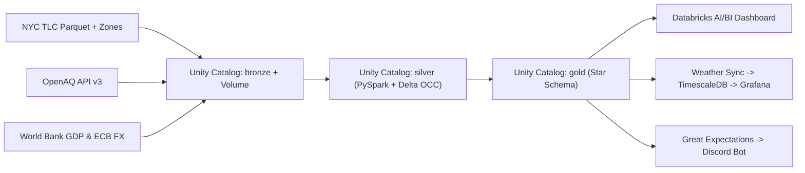

# Databricks NYC Unified Analytics Platform

Medallion lakehouse project built on **Databricks Free Edition** (Unity Catalog, Delta Lake, Serverless Spark, SQL Warehouse, Lakeflow Jobs, AI/BI Dashboards). Combines NYC Yellow Taxi mobility data, OpenAQ air quality measurements, and World Bank GDP / ECB FX macro indicators.

## Data Sources

| Domain | Source | Format | Target Layer |
| :--- | :--- | :--- | :--- |
| Mobility | NYC TLC Yellow Taxi Trips + Taxi Zone Lookup | Parquet / CSV | `bronze` -> `silver` -> `gold` |
| Air Quality | OpenAQ API v3 (NYC sensors: PM2.5, NO2, O3) | Paginated JSON API | `bronze` -> `silver` -> `gold` |
| Economy | World Bank USA GDP & ECB Daily USD/EUR FX | JSON / CSV | `bronze` -> `silver` -> `gold` |
| Weather (ext) | Open-Meteo Archive / Forecast API (NYC) | JSON API | `bronze` -> `gold` -> TimescaleDB |

## Architecture



## Key Features
- **Medallion Architecture:** Raw landing in Unity Catalog Volumes + Bronze Delta tables -> cleaned & deduplicated Silver tables -> Gold Star Schema (`fact_taxi_daily`, `fact_air_quality_daily`, `dim_date`, `dim_zone`, `dim_fx`, `dim_gdp`).
- **Optimistic Concurrency Control:** Native Delta Lake OCC (`WriteSerializable` on fact/silver tables, `Serializable` on watermark control table), idempotent `MERGE INTO` with `tenacity` conflict retry, and explicit `row_version` optimistic locking.
- **Orchestration & Governance:** Serverless Lakeflow Job (DAG + daily schedule), Unity Catalog automatic lineage, table/column metadata comments, and row filter example.
- **External Integrations:** Scheduled weather enrichment sync into TimescaleDB + Grafana (Docker Compose) and on-demand Great Expectations data quality reports triggered via Discord bot.

## Repository Layout

```text
.
├── databricks.yml      # Databricks Asset Bundle (DABs) config
├── resources/          # Lakeflow Job definitions
├── src/                # Setup SQL, Bronze/Silver PySpark notebooks, Gold SQL
├── dashboards/         # Databricks AI/BI Dashboard (.lvdash.json)
├── docs/               # Data dictionary, lineage, governance & OCC notes
├── infra/              # Docker Compose (TimescaleDB + provisioned Grafana)
├── integrations/       # External Python services (weather sync, GX + Discord bot)
└── tests/              # Unit tests (pytest)
```
