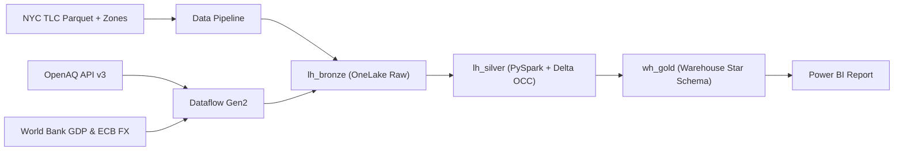

# Microsoft Fabric — Unified Analytics Platform

A unified data engineering and analytics platform built on **Microsoft Fabric** using a **Medallion Architecture (Bronze → Silver → Gold)**. It combines NYC urban mobility, air quality, and macroeconomic data to study how transport intensity, environmental quality, and economic indicators intersect.

## Data Sources (Core)

| Domain | Source | Format | Ingestion Method |
| :--- | :--- | :--- | :--- |
| **Mobility** | NYC TLC Yellow Taxi Trips & Taxi Zone Lookup | Parquet / CSV | Fabric Data Pipeline |
| **Air Quality** | OpenAQ API v3 (NYC sensors: PM2.5, NO2, O3) | JSON (paginated REST API) | Dataflow Gen2 |
| **Economy** | World Bank GDP (USA) & ECB Daily FX (USD/EUR) | JSON / CSV | Dataflow Gen2 |

## Architecture Overview



### Key Architectural Principles
- **Medallion Layers:** Raw ingestion (`lh_bronze`) → cleaned, deduplicated, partitioned Delta tables (`lh_silver`) → Star Schema (`wh_gold`: `FactTaxiDaily`, `FactAirQualityDaily`, `DimDate`, `DimZone`, `DimFX`, `DimGDP`).
- **Optimistic Concurrency Control (DP-700):** Delta Lake native OCC with partitioned `MERGE INTO` + conflict retry, versioned ETL watermark control table (`row_version`), and Fabric Warehouse Snapshot Isolation.
- **Minimal Custom Code:** Built with native Fabric components (Data Pipelines, Dataflows Gen2, Lakehouse, Warehouse, Power BI, Git Integration) and standard libraries.

## Repository Structure

```text
.
├── fabric/        # Synced directly with Microsoft Fabric Workspace via Git Integration
├── docs/          # Data dictionary, lineage diagrams, governance & OCC documentation
├── infra/         # External integration infrastructure (Docker Compose, Grafana)
└── integrations/  # External services (weather TSDB sync, Great Expectations + Discord bot)
```

## Key Analytical Questions
1. How does traffic intensity (trips per day) relate to air quality (PM2.5 / NO2 levels) in NYC?
2. Which zones or times of day show the strongest link between taxi demand and pollution peaks?
3. What is the average revenue per trip in USD vs EUR, and how does exchange rate fluctuation affect it?
4. Over multiple years, do we see mobility/economic growth at the expense of environmental quality?
