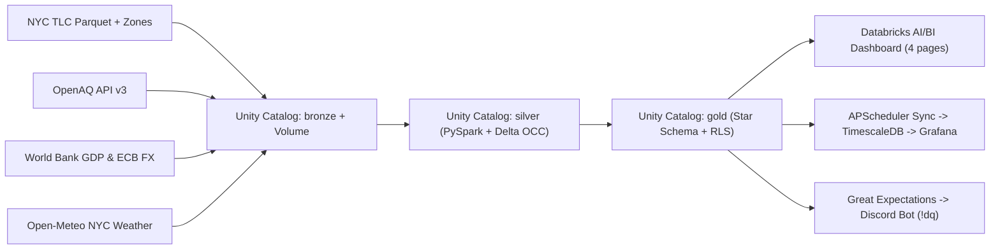

# Databricks NYC Unified Analytics Platform

Medallion lakehouse project built on **Databricks Free Edition** (Unity Catalog, Delta Lake, Serverless Spark, SQL Warehouse, Lakeflow Jobs, AI/BI Dashboards). Combines NYC Yellow Taxi mobility data, OpenAQ air quality measurements, World Bank GDP, ECB FX rates, and Open-Meteo weather data.

## Data Sources

| Domain | Source | Format | Layer Flow |
| :--- | :--- | :--- | :--- |
| Mobility | NYC TLC Yellow Taxi Trips (`2023-06`..`2025-12`) + Taxi Zone Lookup | Parquet / CSV | `bronze` -> `silver` -> `gold` |
| Air Quality | OpenAQ API v3 (NYC bbox: PM2.5, NO2, O3, paginated) | JSON REST API | `bronze` -> `silver` -> `gold` |
| Economy | World Bank USA GDP & ECB Daily USD/EUR FX | JSON / CSV | `bronze` -> `silver` -> `gold` |
| Weather (ext) | Open-Meteo Archive API (NYC daily weather) | JSON REST API | `bronze` -> `gold` -> TimescaleDB |

## Architecture



## Key Features
- **Medallion Architecture:** Raw landing in Unity Catalog Volume + `workspace.bronze` -> cleaned, deduplicated, partitioned Delta tables in `workspace.silver` -> Star Schema in `workspace.gold` (`fact_taxi_daily`, `fact_air_quality_daily`, `dim_date`, `dim_zone`, `dim_fx`, `dim_gdp`, plus analytical views).
- **Optimistic Concurrency Control:** Partitioned Delta `MERGE INTO` with conflict retry (`src/silver/occ_utils.py`), strict `Serializable` isolation + `row_version` compare-and-swap on `workspace.silver.etl_watermarks` (`src/silver/04_occ_watermarks.py`), and live concurrency verification.
- **Orchestration & Governance:** Serverless Lakeflow Job (`resources/nyc_analytics.job.yml`), Unity Catalog automatic lineage, SQL metadata comments, and a Row Filter (`rls_borough_filter`) on `fact_taxi_daily`.
- **Analytics:** 4-page Databricks AI/BI Dashboard (`dashboards/nyc_analytics.lvdash.json`) covering Mobility, Air Quality, Mobility vs Air Quality Correlation, and Economic Impact.
- **External Integrations:**
  - Enriched weather periodic sync (`integrations/weather_sync/sync.py`) into Dockerized **TimescaleDB + Grafana** (`infra/docker-compose.yml`).
  - **Great Expectations** data quality checks (`integrations/data_quality/checks.py`) triggered on demand from **Discord** (`!dq`) via `integrations/discord_bot/bot.py`.

## Quick Start

### 1. Core Pipeline (Databricks)
1. Clone this repository into Databricks via **Workspace -> Create -> Git folder**.
2. Save your OpenAQ v3 API key in `/Volumes/workspace/bronze/raw_landing/.openaq_key` (never in Git).
3. Run in order (or deploy `databricks.yml` as a Lakeflow Job):
   - `src/setup/00_init_unity_catalog.sql`
   - `src/bronze/01_ingest_nyc_taxi.py`, `02_ingest_economy.py`, `03_ingest_openaq.py`, `04_ingest_weather.py`
   - `src/silver/01_silver_taxi.py`, `02_silver_air_quality.py`, `03_silver_economy.py`, `04_occ_watermarks.py`
   - `src/gold/01_build_star_schema.sql`, `02_uc_governance.sql`, `03_enriched_weather.sql`
4. Open `dashboards/nyc_analytics.lvdash.json` in Databricks and click **Publish**.

### 2. Local Setup for External Integrations
```bash
cp .env.example .env   # fill in Databricks SQL Warehouse, PAT, and Discord bot token
python3 -m venv .venv && source .venv/bin/activate
pip install -r requirements.txt
```

### 3. Weather Time-Series Stack (TimescaleDB + Grafana)
```bash
docker compose -f infra/docker-compose.yml up -d
python integrations/weather_sync/sync.py --once   # or drop --once for periodic mode
# open Grafana at http://localhost:3000 (admin / admin)
```

### 4. Data Quality (Great Expectations + Discord Bot)
```bash
python integrations/data_quality/checks.py        # run checks directly in terminal
python integrations/discord_bot/bot.py            # start bot and type !dq in Discord
pytest                                            # run unit tests
```

## Documentation
- [Data Dictionary](docs/data_dictionary.md)
- [Data Lineage](docs/lineage.md)
- [Governance and Optimistic Locking](docs/governance_and_occ.md)
