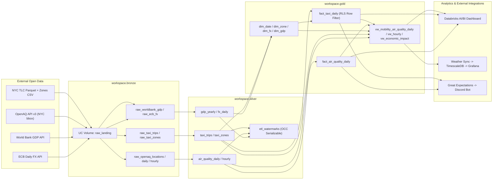

# Data Lineage

## End-to-End Medallion Flow

## Automatic Unity Catalog Lineage
Unity Catalog captures table-level and column-level lineage automatically for every Spark DataFrame and SQL transformation executed on Serverless compute:
1. Open **Catalog** in Databricks UI -> `workspace` -> `gold` -> `fact_taxi_daily`.
2. Switch to the **Lineage** tab and click **See lineage graph** to inspect upstream dependencies (`raw_taxi_trips` -> `taxi_trips` -> `fact_taxi_daily`) and downstream views/dashboards.
